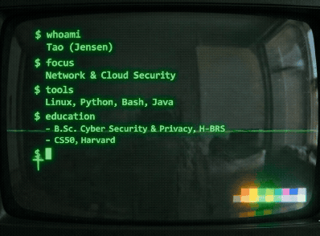

I study Cyber Security & Privacy at H-BRS in Germany. I build small tools for log review and contribute fixes to security and infrastructure projects.

[tzheng.dev](https://tzheng.dev/)

### Projects

- [cloudtrail-quickscan](https://github.com/0xTaoZ/cloudtrail-quickscan): a Python CLI for reviewing AWS CloudTrail logs.
- [authlog-watch](https://github.com/0xTaoZ/authlog-watch): SSH authentication log summaries and a few triage rules.
- [sigma-rule-helper](https://github.com/0xTaoZ/sigma-rule-helper): checks for Sigma rule structure and conditions.
- [Sentinel-IOC-Toolkit](https://github.com/0xTaoZ/Sentinel-IOC-Toolkit): IOC extraction with optional AbuseIPDB enrichment.
- [java-web-log-triage](https://github.com/0xTaoZ/java-web-log-triage): a small Java CLI for web access logs.
- [StudyPulse](https://github.com/0xTaoZ/studypulse-app): a study planner with spaced reviews and recall checks, built on Cloudflare Workers and D1.

### Upstream work

Some of my merged changes:

- [pyinfra](https://github.com/pyinfra-dev/pyinfra/pulls?q=is%3Apr+is%3Amerged+author%3A0xTaoZ): SSH certificate verification, nested ProxyJump connections, sudo with rsync, and operation labels.
- [cfn-lint](https://github.com/aws-cloudformation/cfn-lint/pulls?q=is%3Apr+is%3Amerged+author%3A0xTaoZ): CloudFormation intrinsic functions, SAM resources, and schema validation.
- [Prowler](https://github.com/prowler-cloud/prowler/pulls?q=is%3Apr+is%3Amerged+author%3A0xTaoZ): Kubernetes `hostPath` checks, Google Workspace two-step verification, and ECS task definition handling.
- [Trivy](https://github.com/aquasecurity/trivy/pull/10939): Jenkins plugin license detection.
- [GuardDog](https://github.com/DataDog/guarddog/pull/797): PyPI Inspector links in findings.
- [Graphtage](https://github.com/trailofbits/graphtage/pull/120): INI file support.
- [ansible-lint](https://github.com/ansible/ansible-lint/pull/5110): variable naming checks for registered variables.
